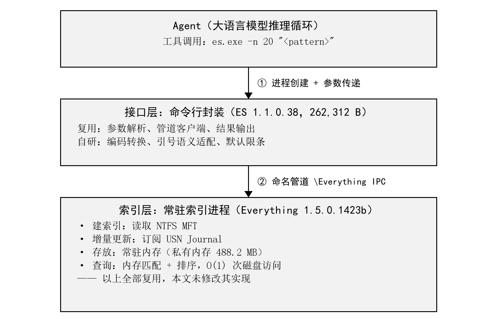

# 面向 AI Agent 的本地文件检索加速：复用桌面索引的接入设计与实测

## 摘要

**目的**：AI Agent 在本机执行文件检索时普遍采用递归目录遍历，在大规模文件系统上产生高延迟与高上下文消耗。**方法**：本文不重写检索算法，而是重新设计 Agent 与既有桌面索引之间的接入契约：将确定性的文件名检索下沉至常驻内存的倒排索引，索引构建与增量维护复用桌面索引工具，命令行接口复用其官方命令行封装；自研部分集中于接口层的编码转换、引号语义适配、默认限条，以及"索引召回 + 内容精排"两级检索策略。**结果**：索引规模 4,170,958 条时，返回 20 条与返回 100 条的端到端延迟分别为 213.78 ms 与 218.06 ms，差值 4.28 ms，小于各自的单次测量标准差（11.80 ms 与 30.16 ms）。该结果说明检索阶段几乎不耗时，端到端延迟由进程创建与 IPC 建立这类固定开销主导。在 931 GB 卷上执行"枚举全部 Markdown 文件"任务，递归遍历耗时 67.851 s、输出 38,916 条路径（4,839,399 字符，约 138.3 万 token）；同一任务经索引接入耗时 0.192 s、返回 20 条（1,440 字符，约 411 token），延迟缩减 353 倍，进入上下文的输出缩减 3,361 倍。**结论**：对 Agent 工具链而言，固定开销与输出规模比检索算法本身更具优化价值；该优化不依赖模型能力，可跨模型移植。

**关键词**：AI Agent；文件检索；倒排索引；命名管道；上下文成本；系统集成

<!--EN-FRONT-->
**Accelerating Local File Retrieval for AI Agents via a Reused Desktop Index: Design and Measurement**

<!--/EN-FRONT-->

---

## Abstract

**Purpose**: AI agents performing local file retrieval commonly rely on recursive directory traversal, which incurs high latency and high context consumption on large file systems. **Method**: Rather than reimplementing retrieval, this paper redesigns the integration contract between an agent and an existing desktop index. Deterministic filename retrieval is offloaded to a memory-resident inverted index; index construction and incremental maintenance reuse a desktop indexing tool, and the command-line interface reuses its official CLI wrapper. The work contributed here concentrates on the interface layer: encoding conversion, adaptation to the quoting semantics of the query syntax, a default result cap, and a two-stage strategy of index-based recall followed by content-level re-ranking. **Result**: With 4,170,958 indexed entries on Windows 11, returning 20 entries took 213.78 ms and returning 100 entries took 218.06 ms; the 4.28 ms difference is smaller than the standard deviation of either measurement set (11.80 ms and 30.16 ms). Retrieval therefore accounts for almost none of the end-to-end latency, which is dominated by fixed costs such as process creation and IPC establishment. For the task of enumerating all Markdown files on a 931 GB volume, recursive traversal took 67.851 s and produced 38,916 paths (4,839,399 characters, approximately 1.383 million tokens), whereas the index-based approach took 0.192 s and returned 20 entries (1,440 characters, approximately 411 tokens), reducing latency by a factor of 353 and output volume by a factor of 3,361. **Conclusion**: For agent toolchains, fixed per-call overhead and output volume offer more optimization headroom than the retrieval algorithm itself. The optimization does not depend on model capability and is therefore portable across models.

**Key words**: AI Agent; file retrieval; inverted index; named pipe; context cost; system integration

**中图分类号**：TP311.5　　**文献标志码**：A

---

## 0 引言

在一个 931 GB 的 NTFS 卷上枚举全部 Markdown 文件，递归遍历耗时 67.851 s，输出 38,916 条路径、约 138 万 token；同一任务经本地索引执行耗时 0.192 s，返回 20 条、411 token。两次执行面对的是同一块磁盘、同一批文件，差别只在于信息从哪里取。

这类差距并非实验构造的极端情形。以大语言模型<sup>[1]</sup>为推理核心的智能体（Agent）正从云端问答走向本机执行，通过工具调用读写本地文件、执行命令、修改代码，其能力边界由可访问的本地资源决定。在这一过程中，**文件检索**是一项高频且基础的操作：用户在自然语言指令中很少给出完整路径，Agent 必须先定位目标文件，才能执行后续读写。

现有 Agent 实现普遍将文件检索建模为目录树遍历问题，即以递归方式枚举候选路径，再通过模式匹配筛选。该做法在文件规模较小时无明显问题，但在现代个人计算机上会暴露两个相互叠加的代价。

时间代价是显性的。递归遍历的时间复杂度与文件系统条目数成正比，每次检索都需重新访问目录元数据；对条目数达百万量级的卷，单次全盘检索可达分钟量级。

上下文代价更容易被忽视，也更昂贵。Agent 的上下文窗口是有限的共享资源，检索结果以路径文本形式进入上下文，与推理过程竞争同一预算。当遍历产生数千行路径而真正相关的仅数条时，绝大部分上下文被无关信息占用，既抬高推理成本，也增加关键信息被淹没的风险。已有研究表明，语言模型对长上下文中间位置信息的利用能力显著弱于首尾位置<sup>[2]</sup>，"全量返回"策略的负面效应因此被进一步放大。

该问题在操作系统层面并不均质。Linux 的 `locate`/`plocate` 与 macOS 的 Spotlight（`mdfind`）均基于预建索引，可把全盘文件名查询压到亚秒级；Windows 虽有 Windows Search，但以内容索引为设计目标，对文件名全盘检索的命令行支持薄弱。这一平台差异使 Windows 上的 Agent 更依赖递归遍历。

本文的思路并非改进检索算法本身，而是**改变 Agent 获取文件系统信息的通道**：将确定性的检索操作从 Agent 的推理循环中剥离，下沉到本地倒排索引层，使 Agent 只接收已排序的少量候选结果。需要说明的是，索引的构建与维护、命令行的封装，本文均复用成熟的桌面检索工具，自研部分集中在两者之间的接入层与面向 Agent 的适配。本文的主要工作如下。

（1）给出一套面向 Agent 的索引接入设计，明确复用边界与自研范围，自研部分包括接口层的编码转换、引号语义适配、默认限条，以及"索引召回 + 内容精排"两级检索策略，并给出各层的工程约束。

（2）给出端到端实测，包括索引规模、查询延迟分布、内存占用与上下文消耗，并揭示"查询延迟与结果集规模无关"这一特性，指出瓶颈位于进程创建与 IPC 建立而非检索，为后续优化指明方向。

（3）报告两项负面实测：索引进程安装为系统服务后命令行接口不可用，表现为错误码 8，根因是命名管道按会话隔离；查询语法中引号表示整名精确匹配，习惯性加引号会使数万条结果归零。两项结论均可复现，可避免同类实现重复踩坑。

## 1 相关工作

### 1.1 检索增强生成

检索增强生成（Retrieval-Augmented Generation, RAG）通过在生成前引入外部知识检索，缓解大模型的知识时效性与事实性问题<sup>[3]</sup>。已有综述从技术演进、检索范式与应用形态等维度对该方向作了系统归纳<sup>[4]</sup>。围绕该范式，研究者从检索粒度、检索时机、结果重排等维度展开了大量工作，并发展出自反思式检索等改进方案<sup>[5]</sup>。中文综述方面，刘雪颖等<sup>[6]</sup>系统梳理了基于大语言模型的 RAG 技术路线。

本文与 RAG 的区别在于检索对象与目标不同。RAG 检索的是**语义相关的内容片段**，服务于问答质量；本文检索的是**精确匹配的文件路径**，服务于 Agent 的操作定位。前者需要语义相似度计算，后者是确定性的字符串匹配问题。因此本文不引入向量检索，而采用倒排索引，其代价结构也与 RAG 有本质差异。

### 1.2 Agent 工具调用

让语言模型自主调用外部工具是 Agent 的核心机制。ReAct<sup>[7]</sup> 将推理与行动交替进行，Toolformer<sup>[8]</sup> 让模型自学工具调用。这些工作关注的是"如何让模型正确地选择并调用工具"，其隐含前提是工具本身足够高效。当工具调用产生大量返回内容时，上下文管理成为新的瓶颈。LLMLingua<sup>[9]</sup> 等工作从提示压缩角度缓解该问题，但压缩属于事后补救，会引入信息损失。在应用层面，智能体已被引入政务服务等实际业务场景，其技术结构与效能机制亦受到关注<sup>[10]</sup>。

本文采取的是**事前削减**策略：在检索阶段就只返回必要结果，使压缩成为不必要。二者可叠加使用，但本文方法与压缩方法在机制上正交。

### 1.3 桌面文件检索技术

桌面文件检索长期依赖操作系统或第三方索引服务。Windows Search 走内容索引路线，Everything 走文件名索引路线，直接读取 NTFS 元数据，在文件名检索场景下响应快出数量级——本文复用的正是后者。在信息检索理论层面，倒排索引与 BM25 排序是成熟技术<sup>[11]</sup>，其工程实现已高度优化。从工程实践角度看，以系统设计与实现为核心的贡献在应用型研究中具有独立价值，如面向特定业务场景的自动化平台设计与实现<sup>[12]</sup>。

上述工作均以**人类用户**为交互对象，其接口设计围绕图形界面展开。本文的关注点不在于索引技术本身，而在于如何将既有的高效索引能力**接入 Agent 的工具调用链**，并量化其收益。这一视角的差异决定了本文的贡献落在系统集成与实证，而非检索算法。

## 2 问题分析

### 2.1 Windows 文件检索的系统级约束

Windows 未向命令行提供原生的全盘文件名秒查接口。`where`、`dir /s` 等命令的实现均为目录遍历，时间复杂度与条目数成正比；Windows Search 服务虽提供索引，但索引范围可配置、以内容索引为设计目标，在纯文件名检索场景下并非最优路径。

换言之，Windows 上的性能问题并非文件系统固有属性，而是**索引能力在命令行侧缺位**导致的。这一判断既解释了问题的来源，也提示了解法：不必重建索引，把已有的索引能力接出来即可。

### 2.2 递归遍历的双重代价

设文件系统条目数为 N，递归遍历需对每个目录执行一次元数据读取，总磁盘 I/O 次数与目录数同阶，总耗时与 N 近似线性。在 Agent 场景中，该遍历不仅耗时，其输出还需完整进入上下文。

设每条路径平均长度 L 字符，则全量输出规模为 N·L 字符。按通用分词经验值折算，其 token 消耗与 N 同阶增长。而实际任务所需的候选通常仅为个位数量级，即有效信息占比不足千分之一。这种"付全量成本、用极少量结果"的结构性浪费，是本文要解决的核心问题。

## 3 方法设计

### 3.1 总体架构与复用边界

本文的接入结构分为三层，如图 1 所示。



**图 1　三层架构与调用路径**

**复用边界需先行说明。** 索引层与接口层并非本文实现：索引构建与增量维护由既有桌面索引工具承担，命令行封装由该工具官方提供的可执行文件承担。本文未修改这两个组件的任何代码，也不掌握其内部实现细节。表 1 给出三层的归属划分。

**表 1　三层结构与复用边界**

| 层 | 既有能力（复用） | 本文工作（自研或适配） |
|---|---|---|
| 索引层 | MFT 读取建索引、USN Journal 增量更新、内存索引与磁盘持久化 | 无。仅在部署侧确定索引范围与排除规则 |
| 接口层 | 可执行文件、参数解析、管道客户端、结果输出 | 编码转换、引号语义适配、默认限条、结构化输出约定 |
| 接入层 | 无 | 调用契约（参数与退出码约定）、两级检索策略、失败回退路径 |

因此本文的贡献不宜表述为"提出一种索引方法"，而应表述为：**测量并改造 Agent 获取文件系统信息的通道**。这一界定也决定了后文的取材——凡涉及索引内部机理的叙述，均标注为既有工具的行为；凡未标注者，均为本文实测或本文设计。

各层职责如下：索引层负责把"每次问磁盘"变为"问一次磁盘、之后问内存"；接口层负责把索引能力包装成 Agent 可直接调用的命令行工具；接入层负责约定调用方式并在失败时给出回退路径。

### 3.2 索引层：复用 MFT 与 USN Journal 索引

本节叙述的索引机理均为既有索引工具的实现，本文未参与，此处仅作必要说明，以便理解后文的测量结果。

该工具直接读取 NTFS 主文件表（MFT）建立文件名索引。MFT 中每个文件与目录对应一条记录，含文件名、父目录引用、大小、时间戳等属性；相较逐目录遍历，一次性读取 MFT 可避免大量目录系统调用。

索引的持续有效性依赖增量更新。NTFS 的 USN 变更日志（Update Sequence Number Journal）记录卷上变更，索引进程订阅该日志后，可在文件创建、重命名、删除时近乎实时地更新内存索引，无需重新扫描。

索引常驻内存并持久化到磁盘，进程重启后无需重建。这一设计把"索引构建"的一次性成本与"查询"的重复收益解耦。

**本文在此层所做的工作只有配置。** 实测环境启用了排除列表（`exclude_list_enabled=1`），将 `node_modules` 在各级深度列入排除路径，同时明确不排除隐藏文件与系统文件（`exclude_hidden_files_and_folders=0`、`exclude_system_files_and_folders=0`）。该配置直接决定了 4.3 节中索引侧与遍历侧命中数的差异，详见该节。

### 3.3 桥接层：命名管道 IPC

索引进程与命令行工具之间通过 Windows 命名管道通信，管道名为 `\Everything IPC`。该管道仅在本机命名空间内可见，不监听 TCP 端口，不产生外部可访问的攻击面。这一特性对 Agent 场景尤为重要：Agent 调用工具时不应引入额外的网络依赖或安全暴露。

选择命名管道而非本地 HTTP，主要是为了不引入端口占用与防火墙授权提示；两者在延迟上的差异本文未单独测量。

**一项负面实测结果值得记录。** 将索引进程安装为 Windows 服务，直觉上可解决"进程必须常驻"的问题。实测表明该方案对命令行接口无效。

机制证据来自运行时观测：在服务与用户会话同时运行的状态下，系统内存在两个同名索引进程，一个位于 Session 0（服务会话），一个位于 Session 1（用户交互会话）；命名管道 `\Everything IPC` 与 `\Everything Service` 同时存在，但由不同会话的进程持有。命令行工具连接的是前者。当用户会话中没有该进程时，连接失败。

失败表现可稳定复现。以不存在的实例名调用，等价于 IPC 不可达：

```
es.exe -instance nosuchinstance -get-result-count "*"
→ stderr: Error 8: Everything IPC not found. Please make sure Everything is running.
→ 退出码 8
```

该复现方式不必停止正在运行的索引进程，因此可直接用作部署验收时的连通性检查。

官方文档亦说明，服务组件的作用是提权代理，而非提供索引服务本身。该结论的实际意义在于：**Agent 的索引后端必须依赖用户会话中的常驻进程**，这决定了部署方案应选择"开机自启"而非"系统服务"。

### 3.4 接口层：工程适配

接口层使用既有命令行工具，其可执行文件体积 262,312 B（约 256 KB），可随项目分发而不构成负担。本文在此层处理了三类问题，均不属于算法范畴，却直接决定方法能否落地。

**编码不一致。** 索引进程输出的路径为 GBK 编码，而 Agent 侧的管道环境通常为 UTF-8。二者直接对接会导致中文路径乱码，现象上表现为"命令执行成功但结果不可用"，易被误判为工具故障。解决方法是在管道中显式转码（`iconv -f GBK -t UTF-8`）。

**引号语义与直觉相反。** 该查询语法中，双引号表示**整名精确匹配**，而非字符串定界；通配符与点号在引号内失去通配含义。实测差异如表 2 所示。

**表 2　引号语义对命中数的影响（H: 卷）**

| 查询式 | 语义 | 命中数 |
|---|---|---|
| `*.md` | 扩展名匹配 | 29,555 |
| `"*.md"` | 整名等于字面量 `*.md` | 0 |
| `README` | 名称含该串 | 1,914 |
| `"README"` | 整名等于 `README`（仅目录） | 6 |
| `README.md` | 名称含该串 | 1,474 |
| `"README.md"` | 整名等于该串 | 0 |

加引号的动机通常是"想精确一点"，实际效果却是把模糊匹配换成整名相等，命中数从万级跌至个位甚至归零。该现象与编码问题叠加时，极易得出"工具不可用"的错误结论。本文的处理方式是在接入契约中禁止对含通配符的查询式加引号，需要短语匹配时改用工具提供的短语运算符。

**结果规模控制。** 默认应限制返回条数（如 20 条），否则大规模结果集会撑爆上下文，反而放大问题。这一约束应在接口层而非调用层强制实施，理由见 3.6 节。

### 3.5 两级检索策略

单一的文件名索引无法覆盖内容检索需求。本文采用两级策略：第一级以索引做候选召回，把百万量级条目缩减至数十条；第二级在候选集内做内容精排（按内容模式匹配或语义重排），仅读取命中文件的正文。

该策略的价值在于控制第二级的输入规模。若直接在全集上做内容匹配，需读取海量文件，I/O 成本不可接受；若仅在已入库资源中检索，则会遗漏大量未整理的文件。索引层恰好提供了"全量召回、极小输出"的中间结果，使两级策略在成本上可行。

### 3.6 工程约束与接入成本

接入过程中遇到的障碍高度集中，且都不属于算法范畴。表 3 汇总了实测遇到的五类问题及其处理方式，可直接作为同类实现的检查清单。

**表 3　接入故障的现象、根因与处理**

| 现象 | 根因 | 处理 |
|---|---|---|
| 命令返回 0 条但工具本身正常 | 查询式加了引号，触发整名精确匹配 | 禁止对含通配符的查询式加引号 |
| 命令执行成功但结果不可用（中文乱码） | 输出为 GBK，Agent 侧按 UTF-8 解码 | 管道内显式 `iconv -f GBK -t UTF-8` |
| 安装为系统服务后返回错误码 8 | 命名管道按会话隔离，服务运行于 Session 0 | 改为开机自启，运行于用户会话 |
| 重启后接口全部失效 | 索引常驻内存，进程退出即失效 | 部署时配置开机自启并纳入验收 |
| 单次检索灌入数十万 token | 默认不限返回条数 | 接口层强制默认限条（如 20 条） |

**常驻性。** 索引位于内存，索引进程退出即失效，因此必须配置开机自启。实测中曾出现"接口调试通过、重启后全部失效"的情况，说明该约束在部署阶段比功能实现更易被忽略。

**内存代价。** 实测索引进程私有内存 488.2 MB，工作集 535.9 MB（索引规模 4,170,958 条）。该开销与条目数正相关，应在方案评估阶段明确计入。

**排除规则的取舍。** 实测环境的排除列表已屏蔽 `node_modules` 各级目录，索引侧因此比全量遍历少 9,400 条 Markdown 条目（见 4.3 节）。该取舍对 Agent 检索基本无损——依赖包目录内的文档对定位用户文件几无贡献——但在要求结果完备性的场景中需显式关闭排除。

## 4 实验

### 4.1 测试环境

测试环境如表 4 所示。全部数据采集于 2026-10-21 至 2026-10-22。索引规模在此期间由 4,170,958 条增长至 4,190,811 条，文中涉及索引规模的数字统一取对应测量时刻的实测值，不做归一化处理。

**表 4　测试环境配置**

| 项目 | 配置 |
|---|---|
| CPU | Intel Core Ultra 5 245KF，14 核 14 线程，基准频率 4.2 GHz |
| 内存 | 127.6 GB |
| 存储 | NVMe SSD（KINGSTON SNV3S1000G，931.2 GB）与 SATA HDD（ST4000NM000A / ST4000DM004，3726 GB 级）混合 |
| 文件系统 | NTFS |
| 操作系统 | Microsoft Windows 11 专业版，版本 10.0.26200 |
| 索引进程 | Everything 1.5.0.1423b (x64)，未修改 |
| 命令行工具 | ES 1.1.0.38，可执行文件体积 262,312 B，未修改 |
| 索引规模 | 4,170,958 条（延迟测量时刻） |
| 索引进程内存 | 私有内存 488.2 MB，工作集 535.9 MB |
| 索引排除规则 | `exclude_list_enabled=1`，排除 `node_modules`；不排除隐藏与系统文件 |

### 4.2 实验设计

实验分为三组。

**第一组：查询延迟分布。** 选取五类典型查询，每类连续重复 30 次，无间隔、无预热。计时以高精度计数器包裹子进程调用的完整周期，起点在进程创建之前，终点在子进程退出之后；因此测量值包含进程创建、映像加载、IPC 连接建立、检索与结果序列化的全部开销，与 Agent 实际感知的延迟一致。五类查询分别为：扩展名查询返回 20 条、另一扩展名的同类查询、关键词查询返回 20 条、扩展名查询返回 100 条、仅计数查询。设置"仅计数"与"返回 100 条"两组，用于检验延迟是否随结果集规模变化。

**第二组：递归遍历基线。** 以递归目录遍历枚举同一卷的全部 Markdown 文件路径，记录总耗时与路径字符总量。该组有两种执行方式：仅累加路径长度而不输出，以及将全部路径完整写出到文件。前者用于与索引查询比较"完成同一判定"的耗时，后者更接近 Agent 实际获取全量结果的情形。两者耗时差异较大，下文分别报告。

**第三组：上下文消耗。** 对比两种方案在相同检索意图下的输出规模，按字符数折算 token。

测量条件有两处局限需先行说明：测试期间未关闭系统 Defender 实时扫描，也未暂停索引进程的自动更新，二者可能对个别样本造成扰动；每组样本未做预热，首个样本可能包含冷启动成本。这两点在 4.3 节讨论异常值时一并考虑。

### 4.3 结果

**（1）查询延迟**

五类查询的延迟统计如表 5 所示。

**表 5　查询延迟统计（n=30，单位：ms）**

| 查询类型 | 均值 | 标准差 | 最小值 | P50 | P95 | 最大值 |
|---|---|---|---|---|---|---|
| 扩展名查询，返回 20 条 | 213.78 | 11.80 | 196.35 | 210.75 | 235.91 | 239.73 |
| 扩展名查询，返回 20 条（另一类型） | 209.11 | 22.49 | 184.51 | 203.49 | 246.74 | 286.77 |
| 关键词查询，返回 20 条 | 211.30 | 23.76 | 179.37 | 203.55 | 251.34 | 265.40 |
| 扩展名查询，返回 100 条 | 218.06 | 30.16 | 187.38 | 208.43 | 268.43 | 311.27 |
| 仅计数查询 | 215.50 | 26.24 | 178.52 | 211.15 | 259.82 | 285.26 |

**（2）延迟与结果集规模无关**

表 5 呈现一个关键现象：五类查询的均值集中在 209 至 218 ms 区间，最大差异 8.95 ms，小于各自的单次测量标准差（11.80 至 30.16 ms）。其中"返回 20 条"与"返回 100 条"的差异为 4.28 ms，"仅计数"与"返回 100 条"的差异为 2.56 ms，均处于噪声水平。

这说明查询阶段本身几乎不耗时，端到端延迟主要由**固定开销**构成，即命令行进程的创建、加载、IPC 连接建立与结果序列化。该结论有明确的优化含义：若把命令行调用改为常驻连接（长驻服务或库调用），延迟有望进一步下降；反之，在现有调用方式下优化索引结构，对端到端延迟的改善有限。

异常值需单独说明。返回 100 条一组的最大值为 311.27 ms，高出该组均值 93.21 ms，约为标准差的 3.1 倍。本次测量未能定位其成因：样本未记录时间戳，无法判断是否落在系统更新或杀毒扫描窗口内。可排除的解释是结果集规模——若 100 条的序列化开销足以造成该延迟，同组其余样本也应普遍偏高，而实测中位数 208.43 ms 反低于均值，说明这是个别样本而非系统性开销。较可能是偶发的磁盘或进程调度抖动，但这只是推测，未作验证。

该现象同时印证了索引式检索的复杂度特性：检索耗时不再与条目数或结果集规模线性相关，而近似为常数。

**（3）递归遍历基线**

为进行公平对比，选取单个卷（H:，容量 931.2 GB，NTFS）作为测试范围，两种方案执行同一语义任务：枚举该卷上的全部 Markdown 文件。结果如表 6 所示。

**表 6　同一任务下两种方案对比（H: 卷，枚举全部 Markdown 文件）**

| 指标 | 递归遍历 | 索引方案 | 比值 |
|---|---|---|---|
| 端到端耗时 | 67.851 s | 0.192 s | 353 |
| 结果条数 | 38,916 | 29,516（命中）/ 20（返回） | — |
| 输出字符数 | 4,839,399 | 1,440 | 3,361 |
| 平均单条字符数 | 124.4 | 72.0 | — |
| 估算 token 数 | 1,382,685 | 411 | 3,361 |

注：索引方案耗时 0.192 s 为同一查询在 H: 卷限定范围内重复 30 次的均值。该值低于表 5 中的全盘查询均值（213.78 ms），原因在于限定路径后结果过滤量与 IPC 返回量同时下降，二者不构成矛盾。

表 6 中的遍历耗时对应"遍历并累加路径长度、不输出全文"的执行方式。若将全部路径完整写出——更接近 Agent 实际获取全量结果的情形——同一遍历耗时 207.46 s，为前者的 3.06 倍。索引方案不受此影响，其输出规模由调用参数决定而非由文件系统规模决定。若以 207.46 s 计，延迟缩减为 1,080 倍。

说明三点。

第一，**耗时差异来自遍历成本而非匹配成本**。递归遍历需访问该卷全部 993,816 个文件的目录项才能完成筛选，成本与文件总数成正比；索引方案的耗时由固定开销主导，与命中数无关。

第二，**两者的命中数存在差异**（38,916 与 29,516），比例约 1.32 倍。该差异的成因经逐条比对已完全定位：两侧路径列表求差集得 9,400 条，全部位于 `node_modules` 目录下，无一例外；反向差集为空，即索引侧不存在遍历侧缺失的条目。

这与 3.2 节所述的排除配置一致。索引进程启用了排除列表，将 `node_modules` 在各级深度排除，同时明确不排除隐藏文件与系统文件。因此该差异并非索引覆盖不全，而是配置层面的有意取舍。一项旁证是：两次采集相隔约 24 小时，两侧命中数各增加 39 条，差值始终为 9,400 条；若差异源于索引滞后或遗漏，差值应随索引增长而波动。

该取舍对本文场景基本无损——依赖包目录内的 Markdown 多为第三方库的说明文档，对定位用户自身文件无贡献。但在要求结果完备性的场景（如全盘资产清点）中，需关闭排除并接受由此带来的索引体积增长。

第三，**输出规模的差异大于延迟差异**。在传统方案下，38,916 条路径约合 4,839,399 字符，按 3.5 字符/token 折算约 138.3 万 token，已远超当前主流模型的上下文窗口上限。这意味着传统方案在完整结果集上**并非"慢"，而是不可行**：实践中必须截断或分批，前者损失完备性，后者以多次往返换取完备性，成本随批次数线性增长。

作为参照，同一卷的全量文件枚举（不施加扩展名过滤）耗时 84.878 s，文件总数 993,816。可见遍历成本主要由目录项总数决定，与过滤条件无关。

**（4）上下文消耗**

表 7 给出不同返回条数下的输出规模。

**表 7　索引方案的输出规模（全盘索引 4,170,958 条）**

| 查询配置 | 返回条数 | 输出字符数 | 估算 token 数 |
|---|---|---|---|
| 扩展名查询，限制 20 条 | 20 | 1,462 | 418 |
| 扩展名查询，限制 100 条 | 100 | 8,364 | 2,390 |
| 仅计数查询 | 0 | 8 | 2 |

由表 7 可见，输出规模与返回条数近似线性，且可通过参数直接控制。这一可控性是本方法相对递归遍历的关键优势：后者的输出规模由文件系统规模决定，调用方无法约束；前者将输出规模变为可调参数，使 Agent 能够按任务需要设定精度与成本的权衡点。

需要说明，token 数按 3.5 字符/token 的通用经验值折算，实际值随模型分词器而变。该折算用于量级比较，不作为精确计量依据。

### 4.4 讨论

两项收益的量级不同，性质也不同。耗时缩减 353 倍，来自把复杂度从与目录项数成正比改为近似常数；输出缩减 3,361 倍，来自把输出规模从由文件系统规模决定改为由调用参数决定。

后者价值更高，但理由不只是"数字更大"。在按 token 计费的商业模式下，上下文消耗直接对应成本，这是最直接的一层。更实质的一层是：冗余信息会稀释有效信号，已有研究指出模型对长上下文中段信息的利用率显著低于首尾<sup>[2]</sup>，削减冗余因此同时改善推理质量。最根本的一层是可行性——传统方案在 931 GB 卷上产生的 138.3 万 token 进不了任何现有上下文窗口，只能截断或分批；截断损失完备性，分批增加往返次数。索引方案把这件事从"必须妥协"变成"按需取用"。

延迟构成的分析则给出一个反直觉结论：**优化索引结构并非当前瓶颈**。五类查询均值集中在 209 至 218 ms，差异小于单次测量标准差，检索阶段几乎不耗时，端到端延迟由进程创建与 IPC 建立主导。同类实现若追求更低延迟，应优先减少进程创建次数（改为常驻连接或库调用），而非改进检索算法。这也意味着本文报告的 353 倍仍有压缩空间。

需要指出，这一结论同时界定了本文方法的价值边界：它优化的是"从磁盘到上下文"的通道，而非检索质量本身。若召回不准，通道再快也只是更快地返回错误结果。

## 5 局限与边界

本文方法存在以下边界，使用时需明确。

**（1）仅覆盖文件名，不覆盖内容。** 倒排索引以文件名与路径为键，无法检索文件内容。内容检索须依赖第二级精排，其成本结构与第一级完全不同。

**（2）平台限定。** 索引构建依赖 NTFS 的 MFT 与 USN Journal，在非 NTFS 卷、网络映射盘及部分虚拟磁盘上不可用。跨平台场景下应改用对应系统的原生索引（如 `plocate`、`mdfind`）。

**（3）依赖用户会话进程。** 如 3.3 节所述，索引进程不能以系统服务形式为命令行接口提供支持，必须运行于用户会话。这在无图形界面的服务器环境中构成限制。

**（4）实测范围为单机单次。** 本文数据来自单一硬件配置与单一时间点，加速比随硬件、文件分布与索引规模变化。文中报告的绝对延迟不具跨环境可比性，但方法层面的复杂度结论可迁移。

**（5）未开展用户研究。** 本文未评估该方法对 Agent 任务成功率的影响，仅报告延迟与成本指标。检索准确率对下游任务的实际影响有待进一步研究。

**（6）复用依赖。** 索引层与接口层均为第三方实现，其行为、性能与接口语义可能随版本变化。本文实测基于 Everything 1.5.0.1423b 与 ES 1.1.0.38；升级后，3.4 节的引号语义与 3.3 节的管道名需重新验证。该依赖也使方法的可移植性受限于该工具支持的平台与文件系统。本文因此不主张它是通用方案，而是一个在特定约束下成本极低的工程选择。

## 6 结论

本文针对 AI Agent 在 Windows 平台执行文件检索时的高延迟与高上下文消耗问题，给出了一套复用既有桌面索引的接入设计，并完成端到端实测。索引的构建与维护、命令行的封装均取自成熟工具，本文的工作集中在接入契约、接口适配、默认限条与两级检索策略。

在 4,170,958 条索引规模下，查询延迟均值 213.78 ms，且与结果集规模无关——返回 20 条与返回 100 条的差异 4.28 ms 小于单次测量标准差。在 931 GB 卷的同一检索任务中，延迟由 67.851 s 降至 0.192 s，进入上下文的输出由 4,839,399 字符（约 138.3 万 token）降至 1,440 字符（约 411 token），分别缩减 353 倍与 3,361 倍。

本文的核心判断是：**AI Agent 的效率瓶颈未必位于模型侧，也可能位于工具链的接口设计**。把成熟的索引能力接入 Agent 的调用链，可在不改变模型的前提下获得数量级改善；而真正耗时的往往不是算法，是那些只有实际部署才会暴露的适配细节——编码、引号语义、会话隔离。这一思路的适用范围不限于文件检索：任何"确定性强、返回量大"的工具调用，都存在类似的下沉空间。

后续工作有三个方向：将命令行调用改为常驻连接，验证固定开销的可压缩空间；评估索引召回质量对下游任务成功率的影响；将该范式推广至其他高频工具调用场景。

## 参考文献

[1] VASWANI A, SHAZEER N, PARMAR N, et al. Attention is all you need[C]//Advances in Neural Information Processing Systems 30. 2017: 5998-6008.

[2] LIU N F, LIN K, HEWITT J, et al. Lost in the middle: how language models use long contexts[J]. Transactions of the Association for Computational Linguistics, 2024, 12: 157-173.

[3] LEWIS P, PEREZ E, PIKTUS A, et al. Retrieval-augmented generation for knowledge-intensive NLP tasks[C]//Advances in Neural Information Processing Systems 33. 2020: 9459-9474.

[4] GAO Y, XIONG Y, GAO X, et al. Retrieval-augmented generation for large language models: a survey[EB/OL]. arXiv:2312.10997v5, 2024[2026-10-21]. https://arxiv.org/abs/2312.10997.

[5] ASAI A, WU Z, WANG Y, et al. Self-RAG: learning to retrieve, generate, and critique through self-reflection[C]//Proceedings of the 12th International Conference on Learning Representations. 2024.

[6] 刘雪颖, 云静, 李博, 等. 基于大型语言模型的检索增强生成综述[J]. 计算机工程与应用, 2025, 61(13): 1-25.

[7] YAO S, ZHAO J, YU D, et al. ReAct: synergizing reasoning and acting in language models[C]//Proceedings of the 11th International Conference on Learning Representations. 2023.

[8] SCHICK T, DWIVEDI-YU J, DESSÌ R, et al. Toolformer: language models can teach themselves to use tools[C]//Advances in Neural Information Processing Systems 36. 2023: 68539-68551.

[9] JIANG H, WU Q, LIN C Y, et al. LLMLingua: compressing prompts for accelerated inference of large language models[C]//Proceedings of the 2023 Conference on Empirical Methods in Natural Language Processing. 2023: 13358-13376.

[10] 王刚, 郑博利, 胡孟晗. 智能体赋能政务服务：技术结构、效能机制与治理路径[J]. 计算机应用与软件, 2026, 43(8): 1-12.

[11] ROBERTSON S, ZARAGOZA H. The probabilistic relevance framework: BM25 and beyond[J]. Foundations and Trends in Information Retrieval, 2009, 3(4): 333-389.

[12] 仝维超, 周殊伦, 鲍中华, 等. 一款无人值守自动化电老炼平台的设计与实现[J]. 计算机应用与软件, 2026, 43(8): 28-31, 54.

---

论文文本采用 CC BY 4.0 许可（如期刊版权协议另有要求，以期刊协议为准）。代码采用 MIT 许可，见仓库根目录 `LICENSE`。
